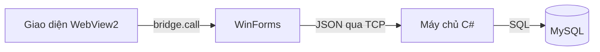

# Quản lý nhà trọ · Ngũ Hành Sơn, Đà Nẵng

Ứng dụng Windows quản lý nhiều khu trọ cho đồ án **Lập trình mạng**. Khách có thể xem phòng trống và đặt lịch ngay khi mở ứng dụng, không cần tài khoản. Sau khi đăng nhập, mỗi vai trò có giao diện riêng để xử lý lịch hẹn, hợp đồng, hóa đơn hoặc hồ sơ cư trú.

[Chạy trên Windows](#chạy-trên-windows) · [Sáu vai trò](#sáu-vai-trò) · [Kiến trúc](#kiến-trúc) · [Kiểm thử](#kiểm-thử) · [Tài liệu](#tài-liệu)

## Từ phòng trống đến lịch xem

1. **Khách xem phòng** chọn một phòng trống, nhập họ tên, số điện thoại và thời gian muốn đến, rồi bấm **Gửi yêu cầu**. Máy chủ ghi yêu cầu đặt lịch và lịch kiểm tra tương ứng trong cùng một giao dịch. Lịch mới ở trạng thái *chờ duyệt*, chưa phải lịch đã xác nhận.
2. **Lễ tân hoặc Quản lý** mở **Lịch kiểm tra**, duyệt hoặc từ chối yêu cầu. Với lịch đã duyệt, người điều phối có thể phân công nhân viên.
3. **Nhân viên** mở **Việc được giao**, nhận việc và đánh dấu hoàn thành sau buổi xem phòng.

## Chạy trên Windows

Cần **.NET 8 SDK**, **Microsoft Edge WebView2 Runtime** và **MySQL 8.0** đang chạy. Mở PowerShell tại thư mục gốc của repo. Các lệnh sau dùng trực tiếp tệp `.csproj`; nếu dùng IDE hỗ trợ `.slnx`, có thể mở [solution QuanLyTro](QuanLyTro/QuanLyTro.slnx).

**1. Khởi động máy chủ.** Dùng tài khoản MySQL phát triển đã cấu hình, có quyền tạo cơ sở dữ liệu và khởi tạo schema. Nếu cấu hình trên máy khác mặc định, đặt biến môi trường `QUANLYTRO_CONN` bằng chuỗi kết nối của môi trường phát triển trong cửa sổ chạy server.

```powershell
dotnet run --project QuanLyTro/QuanLyTro.Server/QuanLyTro.Server.csproj
```

Chờ thông báo máy chủ đang lắng nghe. Server tự tạo cơ sở dữ liệu nếu chưa có và khởi tạo schema. Tài khoản demo chỉ được tạo khi bảng `tai_khoan` còn trống.

**2. Nạp phòng mẫu nếu muốn thử đặt lịch.** Tài khoản demo không đi kèm danh sách phòng. Với DB phát triển mặc định `quanly_nhatro`, mở MySQL CLI từ thư mục gốc rồi nhập `SOURCE Database/seed_demo.sql` tại dấu nhắc `mysql>`. [Tập lệnh mẫu](Database/seed_demo.sql) tạo khu A, khu B và các phòng mẫu ở khu A; tập lệnh chọn đích `quanly_nhatro`, không đọc `QUANLYTRO_CONN`.

**3. Mở ứng dụng** trong cửa sổ PowerShell thứ hai, cũng tại thư mục gốc. Giữ cửa sổ server đang chạy.

```powershell
dotnet run --project QuanLyTro/QuanLyTro.Client/QuanLyTro.Client.csproj
```

Màn hình đầu tiên là **Xem phòng trọ quanh Ngũ Hành Sơn**. Để thử một trong sáu vai trò trên DB demo, chọn **Đăng nhập → Tài khoản demo**, chọn vai trò rồi bấm **Đăng nhập**. Khách thuê mới có thể dùng thẻ **Đăng ký khách thuê** thay vì dùng tài khoản mẫu.

## Sáu vai trò

| Vai trò | Công việc theo quyền mặc định |
| :--- | :--- |
| **Chủ trọ** | Quản lý phòng, hợp đồng, điện nước và hóa đơn; xem doanh thu, duyệt đề xuất, quản lý tài khoản và phân quyền. |
| **Quản lý** | Quản lý phòng và người thuê trong khu được giao; cập nhật tạm trú, lập hợp đồng và hóa đơn, điều phối lịch. Không có báo cáo doanh thu toàn hệ thống. |
| **Lễ tân** | Tra cứu phòng để tư vấn; duyệt, từ chối và phân công lịch kiểm tra; ghi nhận sự cố. |
| **Nhân viên** | Xem lịch của mình, nhận và hoàn thành việc được giao; báo sự cố tại khu trọ. |
| **Khách thuê** | Nhận phòng bằng QR/PIN, cập nhật liên hệ, xem hóa đơn của phòng mình và báo sự cố. |
| **Công an** | Tra cứu người ở theo phòng, xem lịch sử cư trú và xuất hồ sơ tạm trú; không chỉnh sửa dữ liệu cư trú. |

Mã QR/PIN **nhận phòng** gắn với hợp đồng. Mã QR **thanh toán** trên hóa đơn dùng thông tin nhận tiền đã cấu hình; hiển thị mã không có nghĩa là hệ thống đã xác nhận thu tiền.

## Kiến trúc



[HTML, CSS và JavaScript](QuanLyTro/Assets/wwwroot) chạy bên trong WinForms. Khi người dùng bấm **Gửi yêu cầu**, JavaScript gọi `window.bridge.call`; [client C#](QuanLyTro/QuanLyTro.Client/Network/Bridge.cs) gửi gói JSON qua TCP. Mỗi gói kết thúc bằng ký tự xuống dòng và có `requestId` để ghép phản hồi với yêu cầu. Giao diện không kết nối trực tiếp đến MySQL.

- [RequestRouter](QuanLyTro/QuanLyTro.Server/Network/RequestRouter.cs) chuyển yêu cầu đến dịch vụ nghiệp vụ. Với thao tác cần đăng nhập, máy chủ kiểm tra phiên và quyền; thao tác không được cấp quyền bị từ chối. [Danh mục action](QuanLyTro/QuanLyTro.Shared/Protocol/ActionNames.cs) và [ma trận quyền mặc định](QuanLyTro/QuanLyTro.Shared/Protocol/DefaultPermissions.cs) nằm trong project `Shared`.
- [Cấu hình server](QuanLyTro/QuanLyTro.Server/Config/ServerOptions.cs) đọc `QUANLYTRO_CONN` (MySQL), `QUANLYTRO_PORT` (cổng TCP) và `QUANLYTRO_MAX_PACKET` (giới hạn byte mỗi gói). Client mặc định kết nối `127.0.0.1:8888`; chỉ đổi cổng phía server sẽ không đổi cổng phía client.

## Kiểm thử

> [!WARNING]
> Các test tích hợp **xóa rồi tạo lại `quanly_nhatro_test`** trên MySQL cục bộ. [TestDb](QuanLyTro/QuanLyTro.Tests/TestHelpers/TestDb.cs) dùng kết nối riêng, không đọc `QUANLYTRO_CONN`. Chỉ chạy trên máy phát triển có quyền tạo/xóa DB test; không lưu dữ liệu cần giữ trong DB này.

Chạy bộ MSTest để kiểm tra giao thức TCP, phân quyền, nghiệp vụ và các ràng buộc của giao diện:

```powershell
dotnet test QuanLyTro/QuanLyTro.Tests/QuanLyTro.Tests.csproj
```

Để chỉ kiểm tra cấu trúc HTML/JS mà không cần MySQL:

```powershell
dotnet test QuanLyTro/QuanLyTro.Tests/QuanLyTro.Tests.csproj --filter "FullyQualifiedName~UiContractTests"
```

Các test giao diện này đọc tệp nguồn, không mở cửa sổ WebView2. [RealServerE2E](QuanLyTro/QuanLyTro.Tests/E2E/RealServerE2E.cs) là bài kiểm tra riêng qua server thật ở cổng `8888` và được bỏ qua mặc định.

## Tài liệu

[Kế hoạch thực thi đề tài](docs/KEHOACH_THUC_THI_DE_TAI.md) · [Báo cáo đồ án (.docx)](docs/Bao_cao_QuanLyPhongTro.docx) · [Giấy phép MIT](LICENSE)
